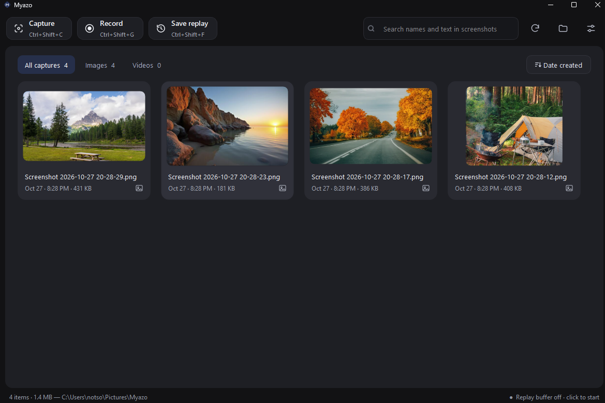

# Myazo

**A local-only screenshot and screen-recording tool for Windows. Think Gyazo, minus the cloud.**

Press a shortcut, capture your screen, and the file lands in a folder you choose. No account, no uploads, no share links. Your screenshots and videos stay on your own drive.



## Why Myazo

I liked Gyazo's workflow: one shortcut, drag a box, done. I didn't want my captures going through someone else's servers. Myazo keeps that workflow and keeps everything on your machine.

- **Local by design.** Files are saved to a folder you pick. Myazo makes no network requests and has no sign-in.
- **Gyazo-style shortcuts.** The defaults match Gyazo's, so muscle memory carries over.
- **Simple.** A tray icon, a library window, one settings dialog. Nothing else to learn.

> Myazo is an independent personal project and is not affiliated with or endorsed by Gyazo.

## How it works

1. Myazo sits in your system tray.
2. Press a capture shortcut. The file is saved straight to your media folder and (optionally) copied to the clipboard.
3. A Windows notification offers **Open in Myazo** or **Open in default app**.
4. Open the library any time from the tray icon to browse, search and reopen what you've captured.

## Features

**Capture**
- Screenshots of a selected region, the active window, or the full screen
- Video recording of a region or the full screen, with system audio and/or microphone
- Replay buffer: keeps the last N seconds in the background and saves them on a shortcut
- Optional PNG or JPEG output, and optional copy to clipboard after every capture

**Library**
- Thumbnail grid of your media folder, with search, an images/videos filter, and sorting by date created, name or file type
- Built-in viewer for images and videos
- Open in folder, open with the default app, or pick an app with "Open with…"
- Copy an image, or copy the current frame of a video, to the clipboard
- Rename and delete (to the Recycle Bin)

**Text in screenshots (optional)**
- Select and copy text straight out of a screenshot with Tesseract OCR
- Recognised text is also searchable from the library

**Settings**
- Customisable shortcuts, media location, video resolution cap, frame rate, audio options, volume normalisation and recording length limit
- Launch with Windows, keep running in the tray, play a sound on capture

## Default shortcuts

| Action | Capture in background | Capture, then open in Myazo |
|---|---|---|
| Capture image | `Ctrl+Shift+C` | `Ctrl+Alt+Shift+C` |
| Capture active window | not set | not set |
| Capture full screen | `Ctrl+Shift+F11` | `Ctrl+Alt+Shift+F11` |
| Record video (region) | `Ctrl+Shift+G` | `Ctrl+Alt+Shift+G` |
| Record full-screen video | `Ctrl+Shift+F12` | `Ctrl+Alt+Shift+F12` |
| Replay: save the last N seconds | `Ctrl+Shift+F` | n/a |

Press `Esc` to cancel a region selection. Press a record shortcut again (or click Stop) to finish. All shortcuts can be changed in Settings.

## Getting started

### Download and run

1. Go to the [latest release](../../releases/latest) and download **Myazo.exe** under **Assets**.
2. Save it somewhere permanent, such as `C:\Users\<you>\Apps\Myazo\`. Myazo is a single file with nothing to install, and no Python is needed. If you turn on "launch with Windows", the startup entry points to wherever the exe is, so don't move it afterwards.
3. Double-click `Myazo.exe`. The first launch can take a few seconds.
4. **If Windows shows "Windows protected your PC":** Myazo isn't code-signed, so SmartScreen warns about every new unsigned app. Click **More info**, then **Run anyway**. You only need to do this once.
5. Look for the Myazo icon in the system tray at the bottom right of the taskbar. If you don't see it, click the **^** arrow to show hidden icons. Right-click the icon to reach the library and settings.
6. Open **Settings** and choose the folder where your screenshots and videos will be saved. Then press `Ctrl+Shift+C`, drag a box over part of your screen, and release. The capture appears in your folder and in the library.

**Optional: verify the download.** Each release includes `Myazo.exe.sha256`. In PowerShell, run the following and check that the output matches the checksum on the release page:

```
Get-FileHash .\Myazo.exe -Algorithm SHA256
```

**Updating:** download the new `Myazo.exe` and replace the old one. Your settings and media are stored separately and are kept.

**Uninstalling:** quit Myazo from the tray menu and delete `Myazo.exe`. To remove everything, also delete `%APPDATA%\Myazo` and your media folder. See [Your data](#your-data).

If a shortcut doesn't work, right-click the tray icon and choose **Open diagnostics log**. It shows which shortcuts Myazo registered and any errors.

### Build from source

Requires Windows 10/11 and Python 3.11 or 3.12.

```
git clone <this-repo>
cd Myazo
build.bat
```

The result is `dist\Myazo.exe`. To run without building, use `run.bat`.

### Optional: text selection (OCR)

Install [Tesseract for Windows](https://github.com/UB-Mannheim/tesseract/wiki) (the UB-Mannheim build). Myazo finds it automatically, or you can set the path in **Settings > More options**.

## Your data

| What | Where |
|---|---|
| Screenshots and videos | The folder you choose in Settings |
| Thumbnails and OCR search index | A hidden `.myazo` folder inside your media folder |
| Settings | `%APPDATA%\Myazo\settings.json` |
| Diagnostics log | `%APPDATA%\Myazo\myazo.log` (tray menu > Open diagnostics log) |

Nothing leaves your machine. Deleting the media folder and `%APPDATA%\Myazo` removes everything Myazo has stored.

## What Myazo doesn't do

Because it's local-only by design, there are no share links, cloud storage, accounts, browser extension, or built-in annotation tools. If you want to share a capture, copy it or send the file yourself.

## Tech

Python with PySide6 (Qt 6) for the interface, `mss` for screen capture, OpenCV and ffmpeg (bundled via `imageio-ffmpeg`) for video, `soundcard` for system and microphone audio, and Tesseract (optional) for OCR. Shortcuts use the Win32 API through `ctypes`. Builds are packaged with PyInstaller.

## Known limitations

- Windows only. Built and aimed at Windows 11.
- Region capture works within one monitor and can't span two.
- Shortcuts won't fire while an app running as administrator has focus.
- The exe isn't code-signed, so Windows SmartScreen may warn the first time you run it.
